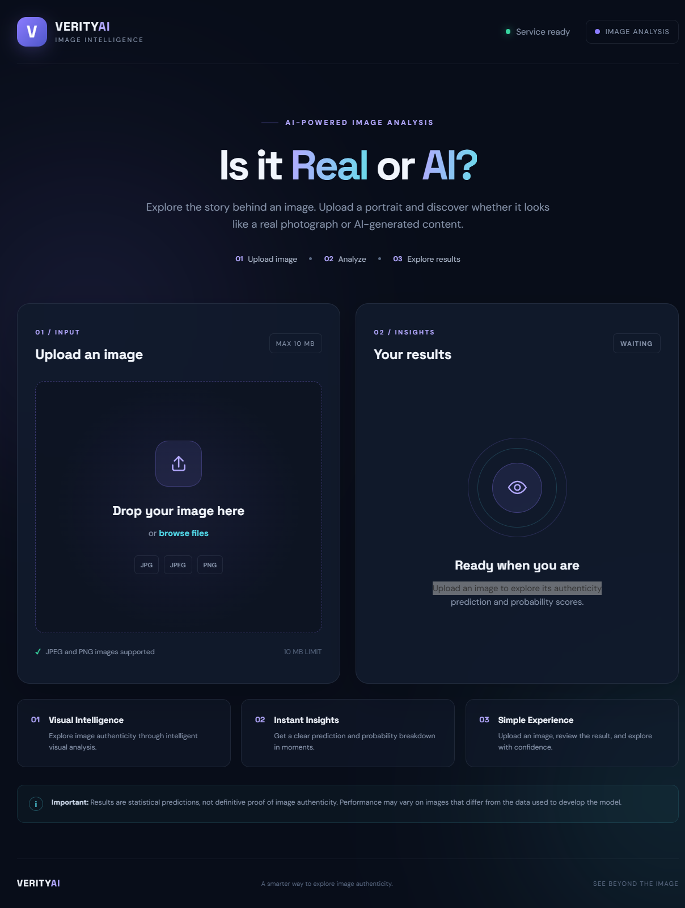
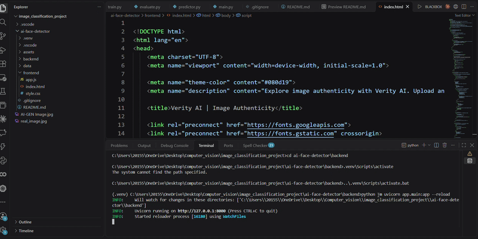

# VERITY AI — Image Authenticity Detector

VERITY AI is an AI-powered image classification application designed to estimate whether an uploaded image is a real photograph or AI-generated content.

The project combines a modern web interface with a Python backend and deep learning image classification.

> **Disclaimer:** Predictions are statistical estimates, not definitive proof of image authenticity. Performance may vary on images that differ from the training data.

---

## Application Preview



## Application Demo



---

## Features

- Upload JPEG and PNG images.
- Drag-and-drop image upload.
- Image preview before analysis.
- Image dimensions and file size display.
- Real vs AI-generated classification.
- Prediction confidence score.
- Probability breakdown for both classes.
- API connection status.
- Loading animations and error handling.
- Responsive and modern dark interface.
- FastAPI-based prediction service.

---

## Kaggle Resources

The project includes a Kaggle notebook documenting the model training and evaluation workflow.

| Resource          | Link                                                                                                        |
| ----------------- | ----------------------------------------------------------------------------------------------------------- |
| Training Notebook | [Human Face Image Classification](https://www.kaggle.com/code/m0hamedramzy/human-face-image-classification) |
| Dataset           | [Human Faces Dataset](https://www.kaggle.com/datasets/kaustubhdhote/human-faces-dataset)                    |

---

## Model Training — MobileNetV2

The Kaggle notebook implements a transfer learning approach using MobileNetV2 pretrained weights.

### Validation Results

| Metric                   | Result |
| ------------------------ | -----: |
| Best Validation Loss     | 0.0147 |
| Best Validation Accuracy | 99.58% |
| Best Epoch               |      2 |

### Test Results

| Metric            | Result |
| ----------------- | -----: |
| Test Loss         | 0.0073 |
| Test Accuracy     | 99.86% |
| Overall Precision |   100% |
| Overall Recall    | 99.73% |
| Total Test Images |  2,167 |

### Classification Report

| Class               | Precision | Recall | F1-Score |
| ------------------- | --------: | -----: | -------: |
| AI-Generated Images |      0.99 |   1.00 |     1.00 |
| Real Images         |      1.00 |   0.99 |     1.00 |

### Test Dataset Distribution

- AI-Generated Images: 1,042
- Real Images: 1,125
- Total: 2,167 images

> **Note:** These results belong to the MobileNetV2 experiment documented in the Kaggle notebook. They are separate from the ResNet50 model used in the current FastAPI application.

---

## Backend Model Evaluation — ResNet50

The FastAPI application currently uses a ResNet50 classification model.

The model was evaluated on a held-out test dataset containing 20,000 images.

| Metric        | Result |
| ------------- | -----: |
| Test Accuracy | 95.67% |
| Test Images   | 20,000 |
| FAKE Images   | 10,000 |
| REAL Images   | 10,000 |

### Confusion Matrix

Class order: FAKE, REAL

```text
[[9556,  444],
 [ 423, 9577]]
```

These results represent evaluation on the project's test split. They do not guarantee the same performance on unrelated images or images generated by unseen AI systems.

---

## Technologies Used

- Python
- TensorFlow / Keras
- MobileNetV2
- ResNet50
- Transfer Learning
- FastAPI
- HTML5
- CSS3
- JavaScript
- Git and GitHub

---

## Project Structure

```text
verity-ai-image-authenticity/
│
├── backend/
│   ├── app/
│   │   ├── main.py
│   │   ├── predictor.py
│   │   └── schemas.py
│   │
│   ├── ml/
│   │   ├── preprocessing.py
│   │   ├── data.py
│   │   ├── model.py
│   │   ├── train.py
│   │   ├── evaluate.py
│   │   └── explore.py
│   │
│   ├── models/
│   │   ├── metrics.json
│   │   └── confusion_matrix.png
│   │
│   ├── tests/
│   ├── config.py
│   └── requirements.txt
│
├── frontend/
│   ├── index.html
│   ├── style.css
│   └── app.js
│
├── assets/
│   └── verity-ai-preview.png
│
├── .gitignore
└── README.md
```

---

## Installation and Setup

### 1. Clone the Repository

```bash
git clone https://github.com/YOUR-USERNAME/verity-ai-image-authenticity.git

cd verity-ai-image-authenticity
```

### 2. Create a Virtual Environment

From the backend directory:

**Windows:**

```powershell
cd backend

py -3.11 -m venv .venv

.venv\Scripts\activate
```

### 3. Install Dependencies

```bash
python -m pip install --upgrade pip

pip install -r requirements.txt
```

### 4. Prepare the Dataset

The backend training dataset is not included in this repository.

Place the dataset in the expected local directory:

```text
data/
└── Real and AI Genersted Images/
    ├── train/
    │   ├── FAKE/
    │   └── REAL/
    │
    └── test/
        ├── FAKE/
        └── REAL/
```

The folder spelling `Genersted` matches the current local configuration in `backend/config.py`.

Update `DATA_DIR` if you use a different directory name.

The Kaggle Human Faces Dataset linked above belongs to the MobileNetV2 notebook experiment. Do not assume it is interchangeable with the backend training dataset without checking the labels, folder structure, preprocessing, and training configuration.

### 5. Train the Backend Model

From the `backend/` directory:

```bash
python -m ml.train
```

The API expects the trained model at:

```text
backend/models/best_resnet50.keras
```

The trained model file is not included in this repository.

For inference, obtain the compatible model separately and place it at the expected path.

### 6. Run the Backend

From the `backend/` directory:

```bash
uvicorn app.main:app --reload
```

The API will be available at:

```text
http://127.0.0.1:8000
```

### 7. Open the Application

Visit:

```text
http://127.0.0.1:8000/
```

The interactive API documentation is available at:

```text
http://127.0.0.1:8000/docs
```

---

## API Endpoints

| Method | Endpoint       | Description                       |
| ------ | -------------- | --------------------------------- |
| GET    | `/api/health`  | Checks API and model availability |
| POST   | `/api/predict` | Analyzes an uploaded image        |
| GET    | `/docs`        | Interactive API documentation     |

### Example Prediction Response

```json
{
  "filename": "example.jpg",
  "label": "REAL",
  "is_real": true,
  "confidence": 0.88,
  "probability_real": 0.88,
  "probability_ai": 0.12
}
```

The values above are illustrative. Actual predictions depend on the uploaded image.

---

## Running with VS Code Live Server

The frontend can also be opened separately using VS Code Live Server.

Add the following configuration before loading `app.js` in `index.html`:

```html
<script>
  window.API_BASE = "http://127.0.0.1:8000";
</script>

<script src="app.js"></script>
```

Add the Live Server origin to `CORS_ORIGINS` in `backend/config.py`:

```python
CORS_ORIGINS = [
    "http://localhost:5500",
    "http://127.0.0.1:5500",
    "http://localhost:8000",
    "http://127.0.0.1:8000",
]
```

Restart the backend after changing the CORS configuration.

---

## Future Improvements

- Expand evaluation using independent datasets.
- Add prediction history.
- Add downloadable prediction reports.
- Integrate Grad-CAM visual explanations.
- Support batch image analysis.

---

## Important Notes

- The dataset is not included in this repository.
- The trained ResNet50 model file is not included.
- The MobileNetV2 Kaggle experiment and ResNet50 backend model are separate experiments.
- Model predictions should not be treated as forensic verification.
- Dataset and pretrained model licenses must be respected.

---

## Author

**Mohamed Ramzy**

- GitHub: [mohamedRamzy-cloud](https://github.com/mohamedRamzy-cloud)
- Kaggle: [m0hamedramzy](https://www.kaggle.com/m0hamedramzy)

---

**VERITY AI — A smarter way to explore image authenticity.**
